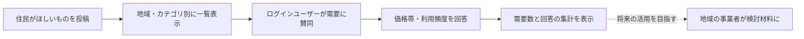
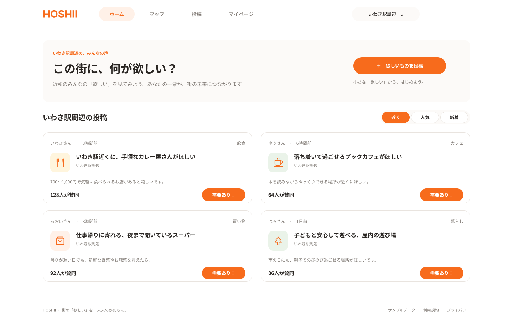
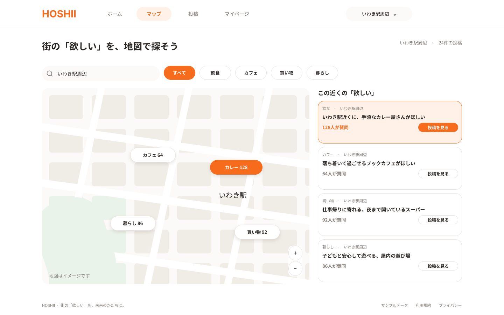
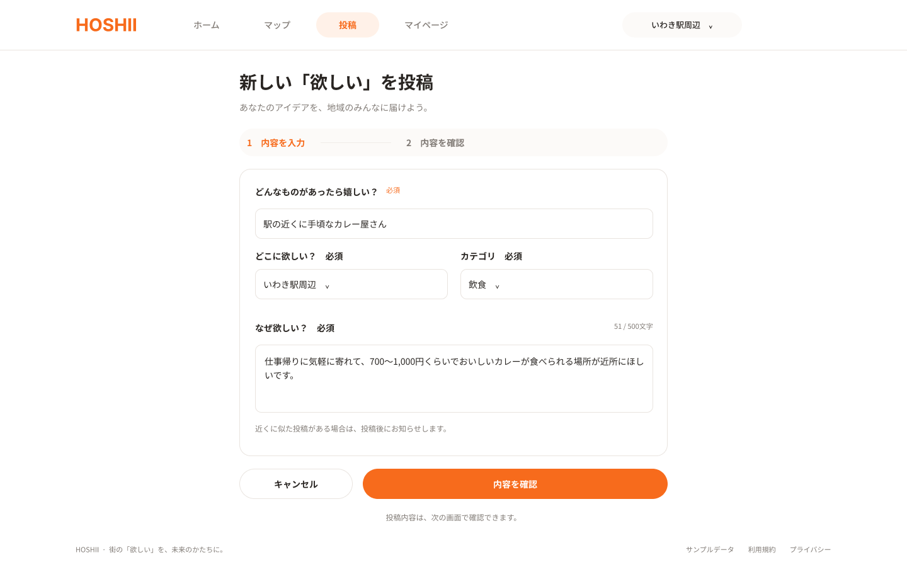
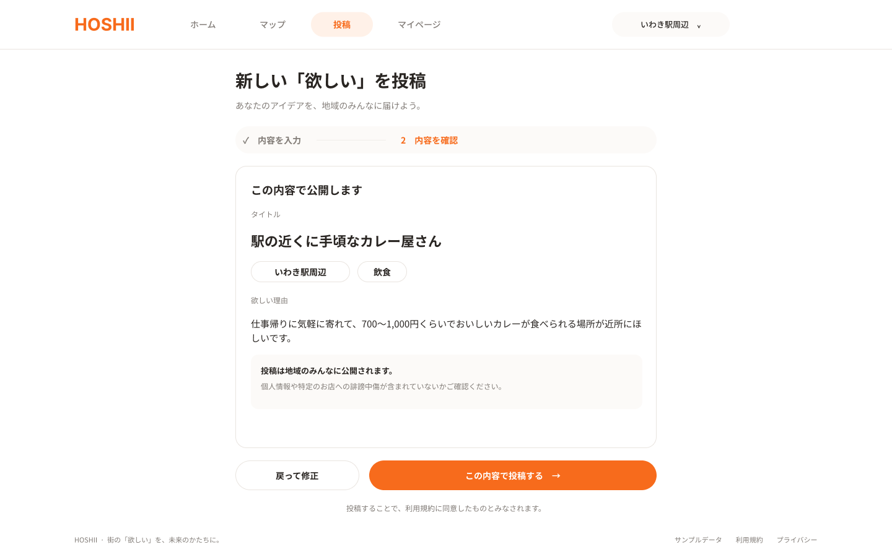
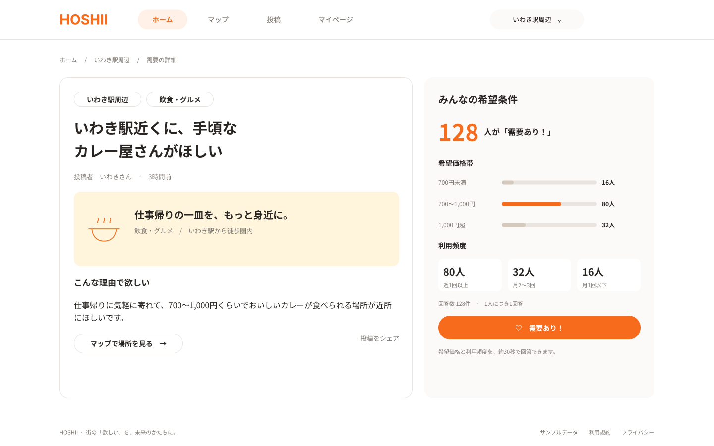
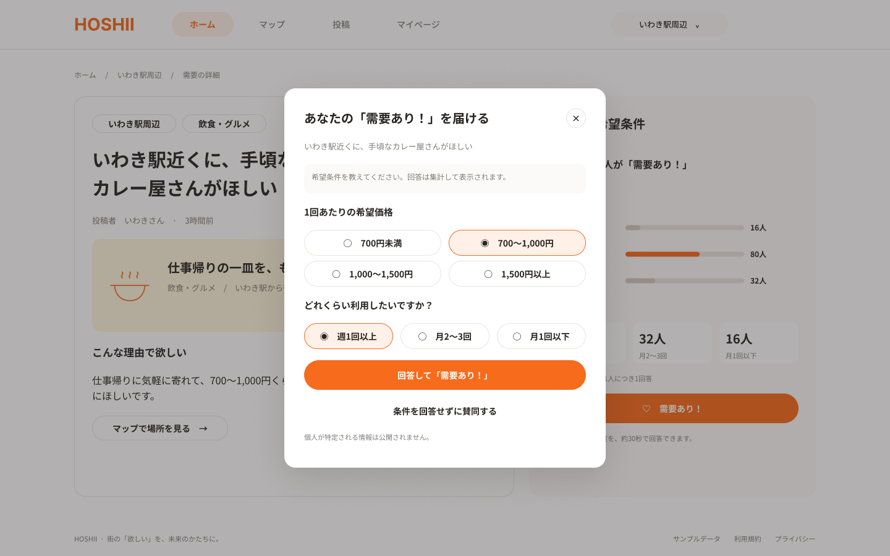
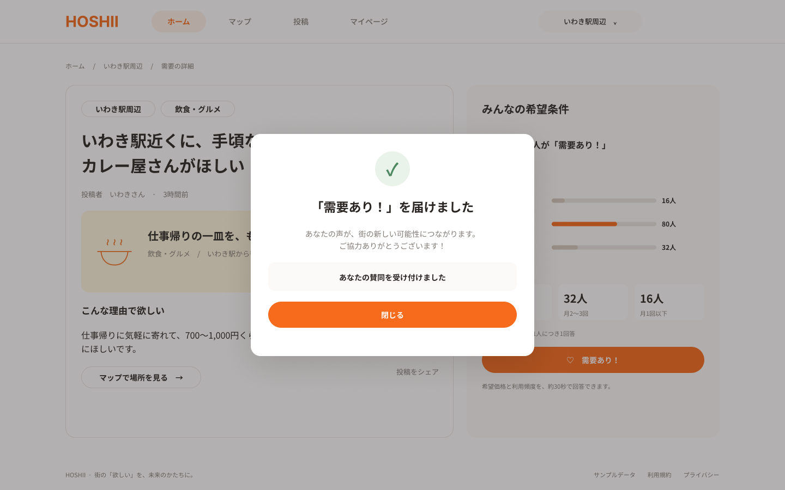
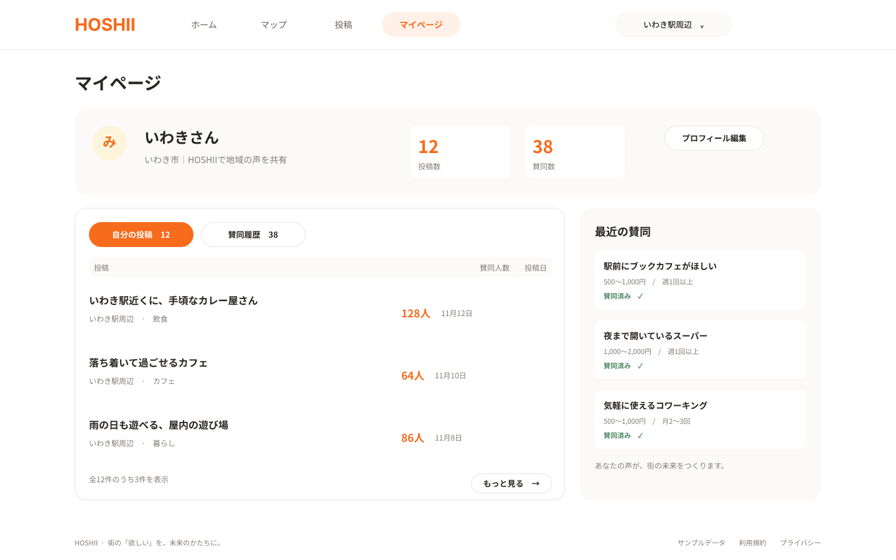
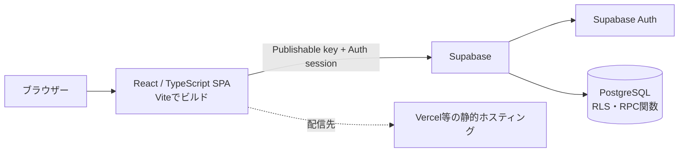

# HOSHII

### 地域の「ほしい」が、まちの未来をつくる。

HOSHII（ホシイ）は、地域の人が「あったらいいな」と思うお店やサービスを投稿し、賛同や利用条件の回答を通じて需要を見える形にするWebアプリです。地域の声を、事業者が出店やサービスづくりを考えるための手がかりにすることを目指しています。

> 現在はMVPの開発段階です。掲載データは市場調査や事業性を保証するものではありません。

## 解決したい地域課題

地域にどんな店やサービスが求められているかは、住民の実感として存在していても、まとまった形で共有されにくいことがあります。一方、出店や新しいサービスを検討する事業者には、地域のニーズを知る機会が必要です。

HOSHIIは、住民の「ほしい」を投稿・賛同・条件回答として集め、地域の需要を可視化することを目指します。現時点で事業者向け分析画面や需要データのダウンロード機能は実装していません。

## サービスの仕組み



## 主な機能

| 機能 | 現在の実装 |
| --- | --- |
| 需要投稿 | ログイン後に、タイトル・地域・カテゴリ・理由を入力して投稿 |
| 一覧・検索 | 新着順／賛同数順、地域・カテゴリで絞り込み |
| 地域別の需要表示 | 地域ごとの投稿件数をカード形式で表示。地図上のピンや座標表示はありません |
| 賛同・条件アンケート | ログイン後に賛同し、希望価格帯・利用頻度・任意コメントを登録 |
| 需要詳細 | 投稿者名、賛同数、価格帯・利用頻度の集計を表示 |
| 投稿者向け操作 | 自分の投稿の編集・削除 |
| アカウント | メールアドレスでの新規登録・ログイン、表示名変更、パスワード再設定 |
| マイページ | 自分の投稿と賛同履歴を表示 |

地域の絞り込み候補は、現在のコードでは「水戸駅周辺」「水戸市内」「いわき市」「その他の地域」です。プロジェクトの初期対象は福島県いわき市ですが、アプリには他の地域候補も含まれています。

## 画面

以下はFigmaで作成したUIデザイン案です。現在のアプリ実装画面そのものではなく、画面内の投稿や賛同数などもサンプルです。特にマップはイメージ表現で、アプリに地図機能が実装済みであることを示すものではありません。

[Figmaで全画面のデザインを見る](https://www.figma.com/design/wVuXNjga18EEZIEpfGHxBJ/HOSHII-v0.1-UI-Design)

<table>
  <tr>
    <td align="center"><strong>ホーム</strong><br></td>
    <td align="center"><strong>需要マップ</strong><br></td>
  </tr>
  <tr>
    <td align="center"><strong>投稿入力</strong><br></td>
    <td align="center"><strong>投稿確認</strong><br></td>
  </tr>
  <tr>
    <td align="center"><strong>需要詳細</strong><br></td>
    <td align="center"><strong>需要アンケート</strong><br></td>
  </tr>
  <tr>
    <td align="center"><strong>賛同完了</strong><br></td>
    <td align="center"><strong>マイページ</strong><br></td>
  </tr>
</table>

## 技術スタック

| 分野 | 採用技術 |
| --- | --- |
| UI | React 19、TypeScript 7 |
| ビルド・開発サーバー | Vite 8 |
| スタイル | Tailwind CSS 4、shadcn/ui CLI 設定、`@base-ui/react`を使ったUI部品 |
| フォント | Inter、Noto Sans JP（Google Fontsから読み込み） |
| ルーティング | React Router 7 |
| アイコン | lucide-react |
| 認証・データベース | Supabase Auth、Supabase Database、`@supabase/supabase-js` |
| テスト | Vitest、PGlite（ローカルのPostgreSQL互換テスト環境） |
| Lint | Oxlint |
| デプロイ設定 | Vercel向けのSPA rewrite設定（`vercel.json`） |

## システム構成



ブラウザーからSupabaseへ直接接続します。フロントエンドにはSupabase URLとPublishable keyを設定します。データ保護はマイグレーションで定義したRLSポリシーとデータベース関数を前提にしています。Service Role keyやSecret keyをフロントエンドへ設定しないでください。

## ディレクトリ構成

```text
src/
├── auth/          # 認証状態とログイン必須ルート
├── components/    # 共通UI部品とナビゲーション
├── contexts/      # 地域フィルターなどの共有状態
├── lib/           # Supabase接続、データ取得、入力検証
└── pages/         # ホーム、マップ、投稿、詳細、認証などの画面
supabase/
└── migrations/    # データベーススキーマ・RLS・関数
tests/             # VitestとPGliteによるテスト
```

## 開発環境のセットアップ

### 必要なもの

- Node.js 20.19以上または22.12以上（Vite 8の要件）とnpm
- Supabaseプロジェクト
- Supabase上に既存の`public.demands`テーブル

### 起動

```bash
git clone https://github.com/k0rrr/hoshii.git
cd hoshii
npm install
cp .env.example .env.local
```

`.env.local`に自分のSupabaseプロジェクトの値を設定します。

```dotenv
VITE_SUPABASE_URL=https://<project-ref>.supabase.co
VITE_SUPABASE_PUBLISHABLE_KEY=<publishable-key>
```

```bash
npm run dev
```

Viteの既定URLは`http://localhost:5173`です。

### Supabaseの準備

`supabase/migrations/20261111000000_hoshii_mvp.sql`は、既存の`public.demands`テーブルを前提にしています。このリポジトリには`demands`テーブルを新規作成する初期スキーマ用マイグレーションが含まれていません。既存スキーマを確認したうえで、開発用プロジェクトに適用してください。

このマイグレーションはプロフィール・賛同・回答テーブル、RLS、関数、制約などを追加します。また、`demands`の既存書き込みポリシーを削除し、投稿者本人に限定するポリシーへ置き換えます。適用前にSQLと対象環境を必ず確認してください。Supabase AuthのRedirect URLsには、ローカルURLと使用するデプロイ先URLを登録します。

### コマンド

| コマンド | 用途 |
| --- | --- |
| `npm run dev` | 開発サーバー |
| `npm run build` | TypeScriptのビルド確認と本番用ビルド |
| `npm run lint` | Oxlint |
| `npm test` | Vitestのテスト一式 |
| `npm run preview` | ビルド結果のローカルプレビュー |

テストにはPGliteを用いたローカルDB上のマイグレーション・RLS検証が含まれます。Supabase Authのメール配信や、本番相当環境への適用後の動作確認は別途必要です。

## 開発状況と今後

### 実装済み

- 住民向け投稿・閲覧・賛同アンケート
- Supabase Authと投稿者単位のデータ保護
- 地域・カテゴリでの絞り込み、需要数の集計
- マイグレーションを使ったDBスキーマとRLSのテスト

### 現在の制約

- 地域別画面は件数表示で、地図や位置情報はありません
- 事業者向け画面、分析レポート、データ出力はありません
- 利用者数や需要データの品質を評価する運用機能はありません
- `public.demands`の初期作成SQLはこのリポジトリにありません

### 今後の検討候補

以下は今後の検討項目であり、実装時期や提供を約束するものではありません。

- いわき市での利用を想定した地域区分・入力体験の検討
- 事業者が需要を把握するための表示方法の検討
- 本番環境への適用手順と運用・プライバシー方針の整備

## 共同開発について

地域の課題やユーザー体験を大切にしながら、MVPを一緒に改善する開発者を歓迎します。開発提案や不具合報告は、GitHub IssuesまたはPull Requestで共有してください。

変更を提案する際は、変更内容と確認したコマンドを記載してください。DB変更を含む場合は、マイグレーションとRLS・権限のテストも更新してください。`.env.local`、認証情報、実在するユーザーデータはコミットしないでください。Supabaseの本番環境へ直接変更を加えないでください。

## ライセンス

このリポジトリには、現時点でライセンスファイルがありません。利用・複製・改変・再配布の条件は定められていないため、ライセンスに関する案内が追加されるまでは権利者の許可なく再利用しないでください。
